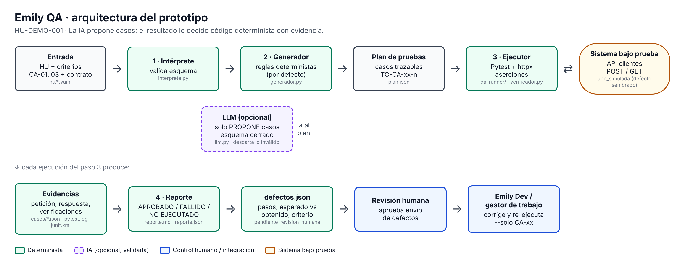
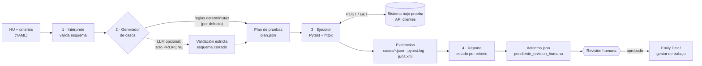

# Arquitectura de Emily QA

## Flujo y responsabilidades

| Paso | Módulo | Qué hace | ¿IA o determinista? |
|---|---|---|---|
| Entrada de la HU | `interprete.py` | Lee el YAML y lo valida con Pydantic (IDs únicos, contrato de la API). | Determinista |
| Interpretación de criterios y generación de casos | `generador.py`, `llm.py` | Reglas que reconocen patrones del criterio (aceptación, correo inválido, edad mínima) y producen casos con valores límite. Opcionalmente un LLM propone casos, que se validan contra un esquema cerrado. | **Aquí la IA aporta valor** (interpretar lenguaje natural, sugerir casos borde). Siempre con validación determinista y respaldo por reglas. |
| Ejecución | `ejecutor.py`, `qa_runner/` | Pytest ejecuta un test por caso; cada test hace las peticiones HTTP reales. | Determinista |
| Validación de resultados | `verificador.py` | Compara status, campos, mensaje y persistencia con lo esperado. | Determinista. **El LLM nunca decide si pasó.** |
| Evidencias | `verificador.py`, `conftest.py` | Guarda petición, respuesta y verificaciones por caso, más log y JUnit de Pytest. | Determinista |
| Reporte y defectos | `reporte.py` | Estado por criterio (APROBADO / FALLIDO / NO EJECUTADO), reporte.md/json y defectos con pasos de reproducción. | Determinista (un LLM podría redactar el resumen, sin cambiar estados) |
| Retroalimentación a Emily Dev | `defectos.json` | Defectos estructurados y trazables al criterio, en estado `pendiente_revision_humana`. | Envío requiere aprobación humana |

## Decisiones de arquitectura

1. **La IA propone, el código decide.** El LLM solo puede llenar un esquema con una lista
   cerrada de verificaciones (`status`, `campo_en_respuesta`, `mensaje_menciona`,
   `persistido`). No puede declarar un resultado: no existe ese campo, y si lo inventa la
   validación de Pydantic descarta el caso (`extra="forbid"`).
2. **Verificar efectos, no solo respuestas.** CA-03 dice «no debe persistirse»; por eso el
   caso consulta la API después del rechazo. Así se detecta el defecto sembrado, que da
   una respuesta 422 correcta pero guarda el registro.
3. **Tres estados, no dos.** Si la API no responde o la herramienta falla, el caso queda
   NO EJECUTADO (skip de Pytest), nunca aprobado ni fallido. FALLIDO exige evidencia
   guardada con una verificación fallida.
4. **Trazabilidad por ID.** `CA-03 → TC-CA-03-1 → casos/TC-CA-03-1.json → DEF-001`. Cada
   conclusión del reporte cita el criterio que la sustenta.
5. **Reproducible.** El modo reglas es determinista (mismo YAML, mismo plan). Los correos
   llevan un sufijo por ejecución para poder repetir contra un servidor con datos.
6. **Supuestos explícitos.** Qué significa «aceptar» y «rechazar» en HTTP está en el bloque
   `contrato` del YAML; el agente no lo adivina.
7. **Pytest como motor.** Da reportes estándar (JUnit para CI), aserciones legibles y
   aislamiento por caso, sin construir un ejecutor propio.

## Límites y control del agente

- No modifica código ni datos del sistema bajo prueba; solo hace peticiones HTTP a la URL
  configurada (`--base-url`) o a la app simulada en proceso.
- Una sola llamada al LLM por ejecución, máximo 3 casos por criterio, timeout de 30 s y
  1 reintento. Si falla, se usan reglas.
- Los defectos no se envían solos: quedan en `pendiente_revision_humana`.
